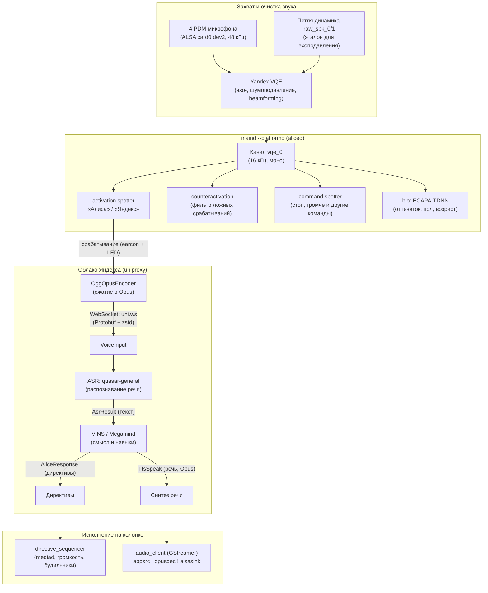

# Голосовой тракт Алисы

Как колонка слышит, распознаёт и отвечает. Снято с Amlogic-Станции (quasar 3.21): по
`quasar.cfg` (`audiod`, `aliced`, `audiosender`, `bio_capability`), моделям в `spotter_models/`
и `bio_lingware/`, путям исходников в `strings maind` и логам `maind.log`. Помечено *(вывод)*
то, что не подтверждено напрямую.

!!! abstract "Главное"
    На устройстве распознаётся **только ключевое слово и ~25 коротких команд**. Полное
    распознавание речи (ASR) и понимание (VINS/Megamind) — **в облаке** (`withLocalVins: false`).
    Без доступа к `uniproxy` колонка не превращает речь в текст.



## 1. Захват звука — `audiod`

Внутри `maind --platformd`. ALSA card 0, device 2 (`PDM-dummy`, в конфиге `dmicarray`),
`inRate` 48000, `micChannels` 4, `spkChannels` 2, `outRate` 16000. Каналы
(`audiosender.availableChannels`): `raw_mic_0..3`, `raw_spk_0..1` (что играет динамик) и `vqe_0`.
`brokenMicDetector` следит за RMS микрофонов.

## 2. Обработка — Yandex VQE

`vqe.type: yandex`, `preset: yandexmini`, `omniMode: true`. Эхоподавление по `raw_spk_*` (Алиса
слышит вас поверх своей музыки), формирование луча, шумоподавление *(вывод по набору каналов)*.
Выход — канал **`vqe_0`**: его слушают спотеры (`spotterChannelName`) и его же отправляют в
облако (`speechkitLogChannels`).

Для Лайт 2 / Plum проверен [захват обработанного `vqe_0`](../recipes/microphone.md)
через экспортированный интерфейс VQE. Конфигурация Plum отличается от приведённого выше
профиля `yandexmini`: два микрофонных канала и один опорный, выход — моно 16 кГц.

## 3. Локальные нейросети

Движок `nnet`, признаки `cmn:lda`, модели в `spotter_models/` (обновляются с CDN Яндекса в
`/data/quasar/data/spotter_model`, сборочные — fallback):

| Модель | Задача |
|---|---|
| `activation/alisa`, `activation/yandex` | ключевые слова «Алиса» / «Яндекс», работают всегда |
| `counteractivation` | подавление ложных срабатываний (например «Алиса» из рекламы по ТВ) |
| `command` | ~25 команд **без** ключевого слова: дальше, назад, громче, тише, стоп, хватит, пауза, играй, включи/выключи, свет, телевизор, блютуз, лайк/дизлайк… (`words.txt`) |
| `vad` | `<speech_started>` / `<speech_finished>` |
| `bio_lingware/*` | голосовой отпечаток (ECAPA-TDNN) + пол/возраст — «узнавание» пользователя (`MatchedUser`, `Biometry.Classification`) |

Подтверждено логом: `command_spotter_capability.cpp: Command phrase spotted: ^ дизлайк`.

### Где лежат модели { #spotter-models }

Пути задаются в `quasar.cfg`, и моделям из `/data` отдаётся приоритет над прошивочными:

```text
"customModelsConfigPath" : "${DATA}/data/spotter.json",
"customModelsPath"       : "${DATA}/data/spotter_model",
"defaultModelsPath"      : "${QUASAR}/spotter_models",
"spotterChannelName"     : "vqe_0",
"spotterModelPath"       : "${QUASAR}/spotter_models/activation/alisa"
```

Прошивочный набор (снято с Лайт 2 / Plum, `0.369.1.50`): `activation/{alisa,yandex,yasmina}`,
`command`, `counteractivation`, `intonationInterruption`, `spotterRecognizer`, `vad`.
Ссылки на зипы — в разделе `spotter` того же `quasar.cfg`; для Plum активационная модель своя,
`ru-RU-plum-alisa-02Jun25-i8-new-flags`.

Скачанное с CDN перечислено в манифесте `/data/quasar/data/spotter.json`: по объекту на модель
с полями `type`, `path`, `url` и `crc`, каталоги названы UUID. Это `/data`, поэтому правки не
требуют `remount,rw` и переживают перепрошивку `system` — но манифест обновляется из облака,
и ручные изменения может перезаписать синхронизация.

### Пороги и состав команд { #spotter-flags }

Модель — каталог с `acoustic_model.nnet`, `words.txt` и текстовым `flags.txt`. Последний
правится без пересборки. У командной модели:

```text
spotter-type chen14
feat-frontend log-mel-fbank
mel-num-bins 40
sample-rate 16000
commands 1:2:3:4:5:6:7:8:9:10:11:12:13:14:15:16:17:18,20:18,21:19,20:19,21:23,25:24,25:26:27
thresholds 0.705:0.284:0.0137:…:0.267:0.724:0.126:0.936:0.968:0.961:0.998
subthresholds 0.705:0.284:0.0137:…
```

`words.txt` задаёт индексы слов (`включи 18`, `выключи 19`, `свет 20`, `телевизор 21`), а
`commands` — фразы, в том числе составные: `18,20` — «включи свет», `18,21` — «включи
телевизор», `19,20`, `19,21`, `23,25`/`24,25` — блютуз. Порог в `thresholds` стоит по позиции
фразы в `commands`.

Отсюда способы повлиять на локальный слой:

- поднять порог к `0.999` или убрать комбинацию из `commands` — фраза перестаёт перехватываться
  локально и уходит в облако (нужно, когда её должен обработать свой прокси, см.
  [Quasar Bridge](../recipes/llm.md#quasar-bridge));
- убрать объект `"type":"command"` из `spotter.json` — командный спотер не поднимется вовсе;
- сменить ключевое слово, переставив `spotterModelPath` на `activation/yandex` или
  `activation/yasmina`.

!!! warning "Чего сделать не получится"
    **Своё ключевое слово не обучить.** Формат закрытый: движок `nnet`, `spotter-type chen14`,
    признаки `log-mel-fbank`, матрица `lda.mat`, веса квантованы (`i8`, `q16`); публичных
    инструментов обучения под него нет, только готовые зипы с CDN Яндекса.
    **Срабатывание перепроверяет сервер** (`SpotterValidation`): в
    `onlineSpotterValidationDisabledTypes` отключены лишь `noise-detection` и `vad`, поэтому
    снижение порога активации облако может отклонить.
    Правка файлов внутри скачанной модели ломает `crc` из манифеста — вероятна перекачка;
    надёжнее подменять каталог целиком или править копию в `${QUASAR}`.

## 4. Активация → поток в облако (SpeechKit)

- На срабатывание: звуковой сигнал earcon (`playStartVoiceInputEarcon`,
  `activation_feedback_player`) и анимация светодиодов.
- `RecognizerSession`/`Recorder` → `OggOpusEncoder` → `UniProxyImpl` по WebSocket на `uniProxyUrl`.
- Протокол: **protobuf Alice API** (`useProtoAliceApi: true`), сжатие **zstd** (`wsUseZstd: true`).
- Соединение держится постоянно (в логе `UniProxyProtocolState … PongTimeoutElapsed` при обрывах).

| Клиентские события | Серверные события |
|---|---|
| `VoiceInput`, `TextInput`, `AsrRecognize`, `LogSpotter`, `MatchedUser`, `TtsGenerate` | `InputStartAck`, `AsrResult`, `SpotterValidation`, `AliceResponse`, `TtsSpeak`, `TtsTimings` |

- `SpotterValidation` — сервер перепроверяет ключевое слово по присланному аудио
  *(вывод по названию)*.
- `vadEnabled: false` → конец фразы определяет **сервер**, а не локальный VAD.

## 5. Облако

ASR: `shortRecognizerModel: quasar-general`, промежуточные гипотезы (`enable_partials`).
`music_recognizer` — распознавание играющей музыки. Диалог и навыки — VINS/Megamind;
`experiments`/`supportedFeatures` сообщают серверу, что умеет устройство (так он и отличает
«болталку» от команд умного дома — маршрутизация на стороне облака).

## 6. Ответ

- `AliceResponse` → `directive_sequencer routeDirective … via <Capability>` (в логе: `set_timezone`/
  `set_location` через GeoSyncCapability, `notify` через NotificationCapability).
- Речь: `TtsSpeak` → `audio_client_tts_player.cpp` → GStreamer:
  `appsrc ! opusparse ! opusdec ! volume ! alsasink`. Музыка — в `maind --mediad`.
- Текстовые запросы (из приложения) идут как `Vins.TextInput` и **минуют ASR**.

## Звук активации { #activation-sound }

Короткий сигнал, который станция проигрывает при обращении, звучит **в начале ответа**, а не на
срабатывании. Прошивка играет сохранённый звук на директиву `tts_play_placeholder` из
`AliceResponse` (`client_action`, payload `{"channel": "Dialog"}`, `IsLedSilent: true`): в логе —
`routeDirective … tts_play_placeholder.activation via AliceCapability`, директива завершается
`completed=SUCCESS` через одну–две секунды, заметно позже `onPhraseSpotted`.

Управляет им настройка «звук активации» в приложении: она приходит с синхронизацией аккаунта
в конфиг станции, в `account_config` это флаг `jingle` (подробно о `"jingle": false` —
[Mini 3 Pro, «Звук»](../devices/station-mini3-pro.md#audio)). При выключенной настройке станция
молчит и на срабатывании, и на ответе; `playStartVoiceInputEarcon` при этом не звучит ни в каком
состоянии — отдельного звука «на слово» у прошивки нет.

Для своего uniproxy-сервера звук доступен без root: достаточно присылать ту же директиву в ответе.
Проверено на Станции Лайт (quasar 0.369.1.46.4778262442.20261013.297) с подменённым `uniProxyUrl`
на эмулятор uniproxy ([quasard](../recipes/llm.md#quasard) с бэкендом своего ассистента): станция
проигрывает свой сохранённый джингл на ответ эмулятора так же, как на ответ облака. Какой именно
файл она при этом играет, не проверялось.

## Отправка аудио помимо запросов

`audiosender` держит кольцевой буфер `historySeconds: 10` по всем 7 каналам.
`cachingSoundLogSender` / `logsound/*` (`SoundLogStorage`, `UniProxyLogSender`,
`random_sound_logger`) отправляют «звуковые логи» срабатываний; случайная запись включена для
групп `allowedForRandomLoggingQuasmodromGroups: ["beta"]`.

## Что это значит для своего ASR/LLM

Это прямо отвечает на вопросы из [«Своя LLM вместо Алисы»](../recipes/llm.md):

- **Текст запроса без uniproxy не получить** — ASR облачный. Нужно либо перехватить поток на
  `uni.ws` (TLS + protobuf, как с quasar-бэкендом), либо забирать звук самостоятельно: каналы
  `vqe_0`/`raw_mic_*` живут внутри `maind`, ALSA-устройство `hw:0,2` занято `audiod`
  *(одновременный захват не проверялся)*.
- **Произнести свой текст** проще всего локально — через API glagol на порту 1961, как это
  делает интеграция YandexStation для Home Assistant — см. [Сеть → glagol](network.md#glagol).
  Для Plum также проверен [вызов `START_VOCALIZE` через SSH](../recipes/sounds.md#native-tts).
  Оба варианта используют облачный синтез; из облака ответ приходит как `AliceResponse.TtsSpeak`.
- **Подмена адреса**: пиннинга сертификатов нет — см. [Подводные камни](gotchas.md).
  Параметр `uniProxyUrl` можно увести на свой сервер, в том числе по `ws://` без TLS.
- **Рабочий пример** — [quasard](../recipes/llm.md#quasard): свой uniproxy (JSON и protobuf
  `AAPI`), ASR, LLM и TTS вместо облака.
- **Часть фраз до своего сервера не дойдёт**: командный спотер обрабатывает «включи/выключи»,
  «свет», «телевизор», «стоп» и прочие ~25 команд на устройстве, без ключевого слова и без
  отправки в облако. Для своих команд либо берите формулировки, которых нет в `words.txt`, либо
  правьте пороги — см. [Пороги и состав команд](#spotter-flags).

!!! warning "Колонка может отправлять фрагменты звука в облако"
    Колонка постоянно держит соединение с облаком, а для «beta»-групп может отправлять случайные
    звуковые фрагменты. Учитывайте это при изоляции колонки от внешнего интернета.
